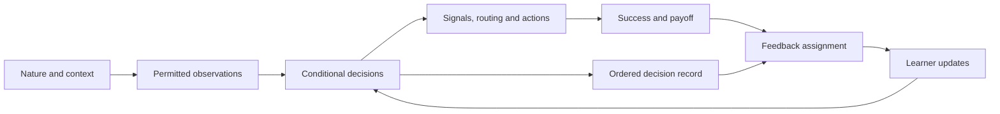

# Architecture derived from the games

The common unit is a **conditional decision**: a module observes a particular circumstance, selects an option, and later changes that option's propensity under feedback. A game connects these decisions through an environment and an interaction schedule. This supports Barrett's assembly of complete strategies from acts, followed by the assembly of interaction structures from learned choices. Sources: [B2 §§2.1–2.3, pp.15–31](https://doi.org/10.1093/9780197793572.003.0002), [B6 §§6.1–6.3, pp.97–110](https://doi.org/10.1093/9780197793572.003.0006), [B13, pp.271–276](https://doi.org/10.1093/9780197793572.003.0013).

## Six contracts

| Contract | Required content | Examples |
|---|---|---|
| Environment | State distribution, persistent state, observation projections, success predicate, payoff function | Uniform state, NAND truth inputs, private inquiry reliability |
| Module | Stable identity, owner, role, observation space, urns, learner state | Basic sender, executive receiver, translator |
| Decision | Observation key, available options, response rule | State→signal; context→active senders; source→consultation |
| Interaction | Execution order, information delivery, termination, resets | Sender then receiver; repeated questions; asynchronous inquiry rounds |
| Feedback | Explicit state targets, outcome/payoff, timing, update multiplicity | Shared match reward; visitor-only link reward; translator-only punishment |
| Experiment | Phases, seeds, evaluation protocol, measures, source profile | Train/freeze/transfer; repeated fresh bandit tasks; source reproduction |

A source game is defined by all six. Sharing urn storage alone does not make two experiments the same game.

## Urn and learner state

An urn has a stable ID, a context key, ordered option IDs, and nonnegative numeric weights. Its normalized weights are the mixed conditional disposition. Learners may own additional state: current pure assignments, a reference point, forgetting clocks, or the current iterative phase.

Use weights directly. “Return the drawn ball” means sampling leaves the original weights intact. The learner subsequently adds or removes the prescribed amount. This avoids accidental double replacement. Floors apply only where the source requires them: ordinary positive reinforcement starts positive; punishment models typically keep one ball per existing type; ARP uses its separate small positive floor.

The game requests the observation and options; the response rule chooses; the learner updates. This separates proportional sampling from WSLS-style persistence and other response mechanisms. A complete-strategy urn is valid where the book uses it, but its options are entire plans rather than individual acts.

## Ordered draw records

Every play records each decision occurrence:

`(time, module_id, urn_id, observation, chosen_option, phase, provisional_creation)`.

A feedback event names its adaptive-state targets, outcome success, numeric payoff, and originating occurrences where applicable. Credit can reach an unsampled host option, a newly invented option, or an entire propensity vector. Dialogue can visit the same urn and choose the same option several times. Keep an ordered sequence rather than collapsing occurrences into a set. A frozen module can still draw and produce output while its adaptive state remains unchanged. An inactive sender contributes no draw or learning event.

Chance events also record nature, scheduling, noise, randomized completion, and task construction. Structural events record creation, commit, rollback, and deletion. A module invocation evaluates once; all consumers of that invocation reuse its output.

Checkpoints contain all urns, current assignments, learner state, environment state, clocks, ID allocation state, and random generator state. A seed alone is useful within a pinned implementation; event records support diagnosis across implementation changes.

## Roles and ownership

Represent an organism or social agent separately from the modules it owns. The coding game has two senders; the arithmetic model interprets comparable senders as functional parts of one animal. An executive module controls other modules without becoming the same decision process. The FFSR network model equips every agent with a sender and receiver plan.

Ports identify what is carried: a binary observation, an arbitrary signal token, a cardinal output, a named feature, a material request, or a belief. Sender identity is part of a coding expression. A pair `(A:0, B:1)` is ordered and cannot be silently treated as an unordered bag.

## Composition operations

| Operation | What is assembled | Required specification |
|---|---|---|
| Parallel expression | Two sender outputs form one ordered expression | Identity, output alphabet, joint receiver key |
| Serial composition | A module output becomes another module's observation | Port compatibility, timing, representation adapter |
| Source selection | A salience urn chooses a nature feature or module output | Available sources, selected-source feedback |
| Template transfer | New stimuli select old input urns | Translator tables, fixed old components, transfer success criterion |
| Executive control | A context selects active senders or output interpretation | Observation restrictions, activation mask, cost |
| Dialogue | A question triggers a reply and a subsequent decision | History key, turn budget or termination, exchange costs |
| Partner selection | A visitor chooses a host | Eligible agents, game played, visitor/host updates |
| Invention | An option and dependent urns are introduced | Provisional creation, first-use acceptance, rollback, forgetting |
| Meta-learning | A chosen learner acts on a fresh lower-level task | Inner reset, outer reward, clocks and persistence |

These are proposed software operations grounded in the corresponding game families. Keep their feedback semantics explicit. For example, template transfer freezes old tables, whereas attention learning changes salience and signaling tables together.

## Time and reset semantics

| Clock | Meaning | Persistent state |
|---|---|---|
| Play | One state-to-outcome task | Urns across plays |
| Turn | One move within discourse | Draw history until termination |
| Network round | Each agent makes one visit/consultation | Partner urns and strategies |
| Inquiry problem/generation | Fresh inquiry target and initial false beliefs | Consultation urns survive; beliefs reset |
| Training phase | Pretraining, freeze, transfer, changed payoffs | Specified modules retain learned tables |
| Meta trial | Fresh instance evaluated under a selected learner | Outer learner survives; inner learner usually resets |

An inquiry “generation” is a repeated epistemic problem, not biological reproduction. Network games and inquiry require different schedulers. In inquiry, a random permutation updates beliefs immediately; batch updating at the end of a round changes the model.

## Exact policy evaluation and measurement

For a basic signaling game, let `P(s|x)` be the sender policy and `P(a|s)` the receiver policy. Given state probabilities `μ(x)`, current exact success is

`Σ_x μ(x) Σ_s P(s|x) P(a=x|s)`.

For coding, multiply the two conditional sender policies and sum over ordered signal pairs. For NAND, use the target truth function as the matching action. Small finite games can enumerate all paths; dialogue with unlimited turns needs a termination analysis or an explicitly labeled truncation.

Store separately: realized cumulative accuracy, recent-window accuracy, exact current-policy accuracy, net reward, expression length, dialogue depth, and source-specific efficiency. Optional mutual information should use the actual joint distribution and log base two. Perfect signaling of uniform `n` states conveys `log2(n)` bits; biased nature has state entropy `H(X)` instead.

The reported book percentages are reference observations from its simulations. They are not assertions that a short demonstration must reproduce those percentages. Thresholds, run lengths, initial weights, and cumulative versus final measurements belong in the experiment profile.

## Proposed implementation shape after review

The Python package uses NumPy for numeric urn tables and random sampling. It begins with finite environments, explicit interaction functions, and common learner/trace interfaces. Add dynamic dictionaries for invention and dialogue only when their families arrive. Preserve semantic IDs even when a faster array representation is introduced.

Suggested modules: `core` (IDs, urns, traces, clocks), `learners`, `games`, `composition`, `experiments`, and `metrics`. Game definitions should remain readable enough to compare with the book. An arbitrary graph interpreter or generic theorem framework is unnecessary for the first executable milestone.

Expose complete conditional tables alongside sampled trajectories. This is the “full-state” representation: every module's decision contexts, option weights, additional learner state, and current interaction state are inspectable. It does not give agents observations that their game withholds.
